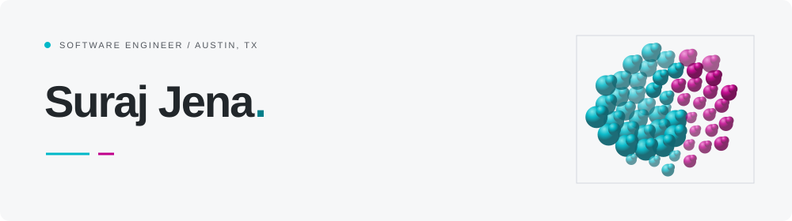

<picture>
  <source media="(prefers-color-scheme: dark)" srcset="docs/profile/header-dark.svg">
  
</picture>

### Hi, I’m Suraj.

I’m a software engineer at **Comcast**, based in **Austin, Texas**. I work across machine learning, event-driven systems, and tools that help engineers build better software.

Previously, I worked on chatbot intent classification at **Wells Fargo**, including Python ML pipelines and model explainability. I studied computer science at **UC Davis**.

[Website](https://dunkelhaus.github.io/dunkelhaus/) · [LinkedIn](https://www.linkedin.com/in/skjena/) · [Résumé](public/suraj-jena-resume.pdf)

#### Areas of work

- **Machine learning:** understanding smart-home behavior through predictive models and activity insights.
- **Software systems:** event-driven infrastructure on AWS, time-series data, and reliable customer-facing workflows.
- **Engineering tools:** AI-assisted development, clearer code, and sharing ideas across teams.

#### A few tools I work with

  <picture>
    <source media="(prefers-color-scheme: dark)" srcset="docs/profile/tool-python-dark.svg">
    
  </picture>
  <picture>
    <source media="(prefers-color-scheme: dark)" srcset="docs/profile/tool-go-dark.svg">
    
  </picture>
  <picture>
    <source media="(prefers-color-scheme: dark)" srcset="docs/profile/tool-aws-dark.svg">
    
  </picture>
  <picture>
    <source media="(prefers-color-scheme: dark)" srcset="docs/profile/tool-js-dark.svg">
    
  </picture>
  <picture>
    <source media="(prefers-color-scheme: dark)" srcset="docs/profile/tool-pytorch-dark.svg">
    
  </picture>
  <picture>
    <source media="(prefers-color-scheme: dark)" srcset="docs/profile/tool-mqtt-dark.svg">
    
  </picture>

---

This repository also powers my personal website. [Development & deployment guide](docs/development.md).
